<div align="center">

# Space Radar

**A live 3D map of space in your browser, from your own street to the Milky Way.**<br>
Free, open source, no account. It tells you what is measured and what is modelled.

### [Open it: www.spaceradar.ai](https://www.spaceradar.ai/?from=gh)

<a href="https://www.spaceradar.ai/?from=gh">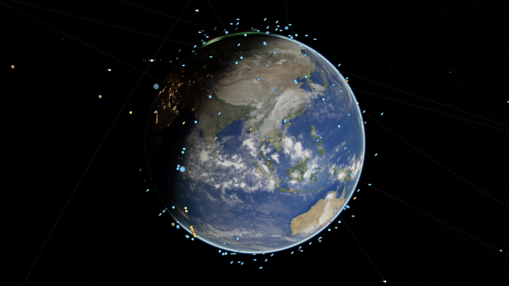</a>

[](https://github.com/Sara-Managed-Projects/space-radar/actions/workflows/ci.yml)
[](LICENSE)
[](https://github.com/Sara-Managed-Projects/space-radar/releases/latest)
[](https://www.spaceradar.ai/?from=gh)
[](https://github.com/Sara-Managed-Projects/space-radar/labels/good%20first%20issue)
[](https://codespaces.new/Sara-Managed-Projects/space-radar)

</div>

Space Radar draws the Earth with today's clouds and about 17 000 satellites where they are this
minute, the rockets about to launch, the planets and their moons, the ground where spacecraft landed
on the Moon and Mars, tonight's sky over your own street, 2.5 million stars in 3D, and the black
holes the Event Horizon Telescope photographed. Narrated trips fly the camera for you. Every position
is worked out in your browser from public data, and every picture says whether it is measured,
modelled or an artist's impression, with its source. It is a static website: no account, no adverts,
no tracking, and it runs with no internet too.

## Run it in 30 seconds

Nothing to install, nothing to compile. Python's built-in server is the whole toolchain:

```bash
git clone https://github.com/Sara-Managed-Projects/space-radar.git
cd space-radar && python3 -m http.server 8177 --directory site      # then open http://localhost:8177
```

33 narrated trips (248 stops), 109 389 stars from HYG plus 2 411 200 more from AT-HYG, 51 star
systems to fly into, every planet and 21 moons (20 of them with a real map), and more than 300
spacecraft and shape models. The [long version](#run-it-locally) covers Windows, classrooms and
running with no internet.

**Follow:** [YouTube](https://www.youtube.com/@SpaceRadar_ai) ·
[Instagram](https://www.instagram.com/spaceradar.ai/) ·
[LinkedIn](https://www.linkedin.com/company/spaceradar-ai) ·
[the Journal](https://blog.spaceradar.ai) ·
[Discussions](https://github.com/Sara-Managed-Projects/space-radar/discussions) ·
[Roadmap](ROADMAP.md) ·
[FAQ](docs/FAQ.md)

## What it is

One map, from your own street to the edge of the Milky Way, on one clock you can move. Below is what
it does today, each with a picture taken from the live app on 12 November 2026. Where a picture is
drawn from a model rather than a measurement, the app says so on screen, and so do these captions.

<table>
<tr>
<td width="50%" valign="top">
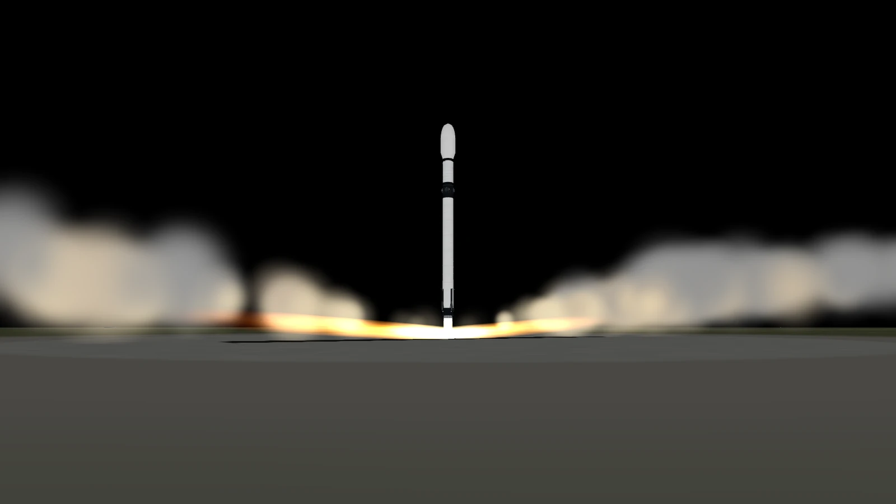
<h3>Live satellites and launches</h3>
About 17 000 satellites, worked out in your browser from CelesTrak's orbital elements with SGP4:
the space stations and who is aboard, Starlink trains, debris clouds, and when each one passes over
you. A countdown chip names the next launch; twelve narrated Moments replay famous flights, from
Sputnik 1 to the first Falcon 9 landing.
</td>
<td width="50%" valign="top">
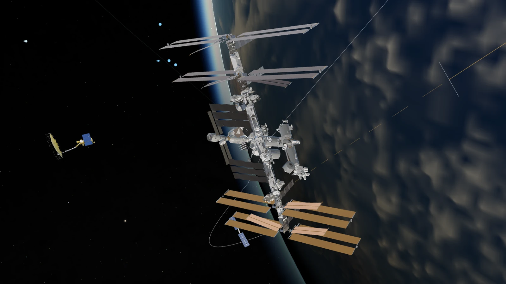 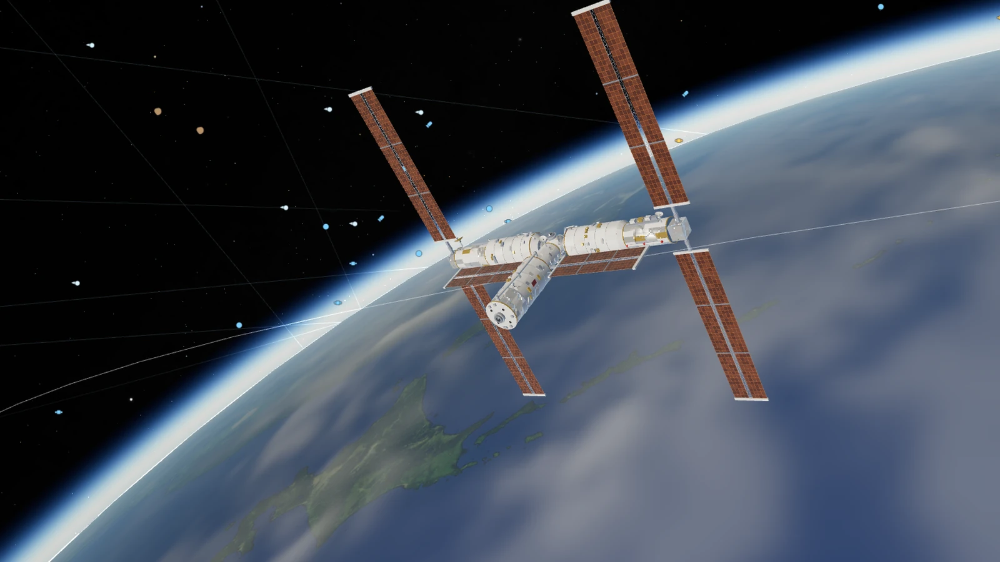
<h3>3D models of real spacecraft</h3>
More than 300 spacecraft and shape models: NASA's own where they exist, and the rest built from
published dimensions and photographs. Select the ISS, Tiangong, Hubble or a Starlink and it is drawn
where it is now, lit by the Sun as it is now. The models are free to use at
<a href="https://models.spaceradar.ai">models.spaceradar.ai</a>.
</td>
</tr>
<tr>
<td valign="top">
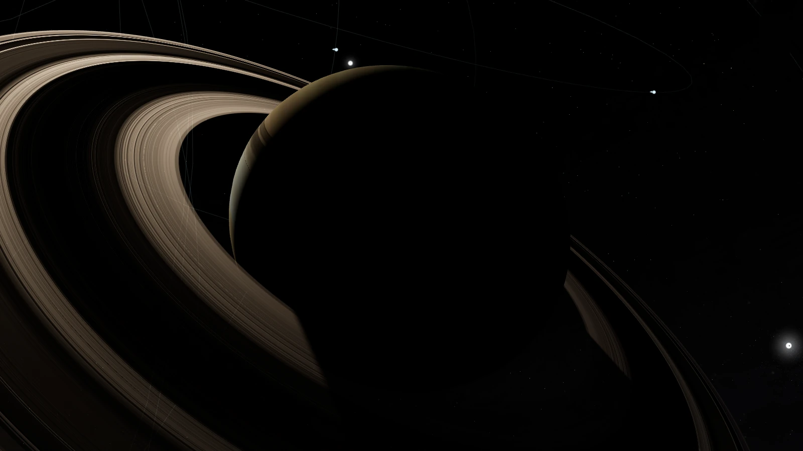
<h3>The planets and their moons</h3>
Every planet and 21 moons (20 of them with a real map), placed by an ephemeris for the instant on
the clock. Look inside sixteen worlds, set the sizes from true scale to a classroom orrery, and fly
to Pluto, Voyager 1 or the edge of the heliosphere.
</td>
<td valign="top">
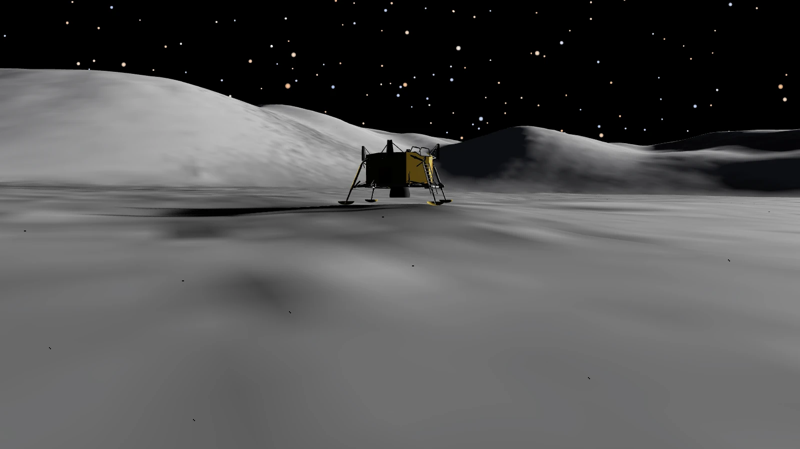 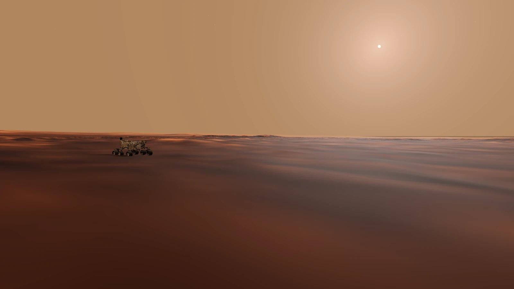
<h3>The ground where we landed</h3>
31 places on the Moon and twelve on Mars that spacecraft reached, each on its own card with its
sources. At eight of them you can stand and walk on the ground as orbiters measured it, Apollo 11,
15 and 17, Chang'e 4, Gale, Jezero, Utopia and Opportunity's rim, and drive four rovers.
</td>
</tr>
<tr>
<td valign="top">
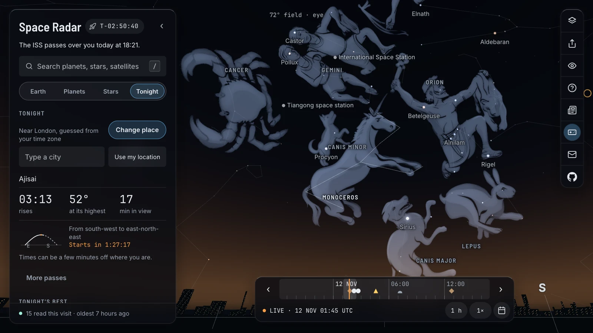
<h3>The sky from your street</h3>
Tonight's sky from where you are: the constellations, the planets, the Moon, tonight's best passes of
the ISS and other satellites, and a city, town or dark sky. Turn on the pictures, the borders, the
Sun's path, a grid or the red night light.
</td>
<td valign="top">
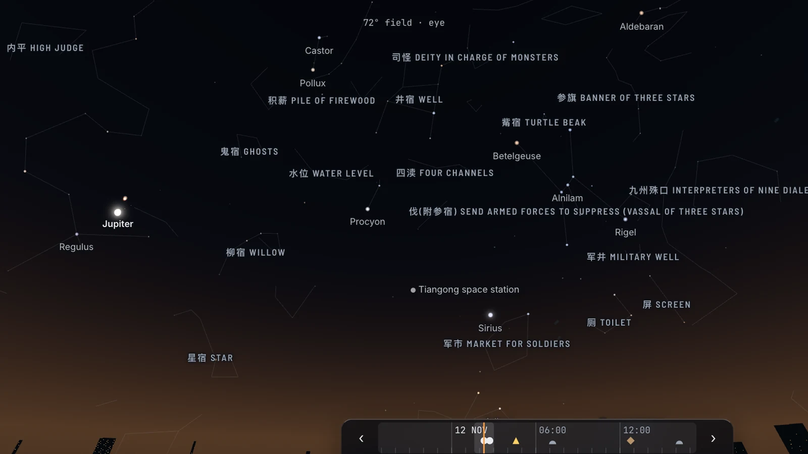
<h3>Eight sky cultures</h3>
The Western figures, and the skies of Chinese, Māori, Hawaiian, Samoan, Tongan, Norse and Boorong
astronomy, from Stellarium's documented reconstructions. Tap a figure to read its story. The
controls say whose reading each one is.
</td>
</tr>
<tr>
<td valign="top">
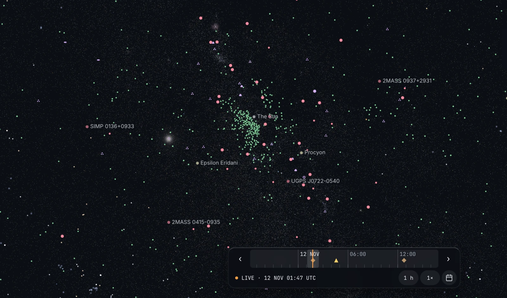
<h3>2.5 million stars in 3D</h3>
HYG's 109 389 stars and AT-HYG's 2 411 200 more, each at its measured distance, fetched round the
camera as you fly. Leave the Solar System, look back from 50 light-years, and fly into any of 51
star systems.
</td>
<td valign="top">
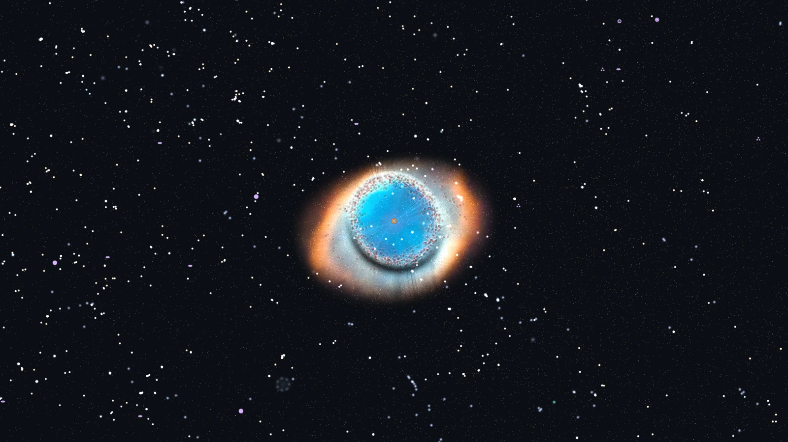
<h3>The deep sky</h3>
Nebulae and galaxies in 3D at their true places, built from published measurements, and the
telescopes' photographs of 30 nebulae and galaxies to compare them with on their cards. The whole sky
in other light too: infrared, microwaves, gamma rays.
</td>
</tr>
<tr>
<td valign="top">
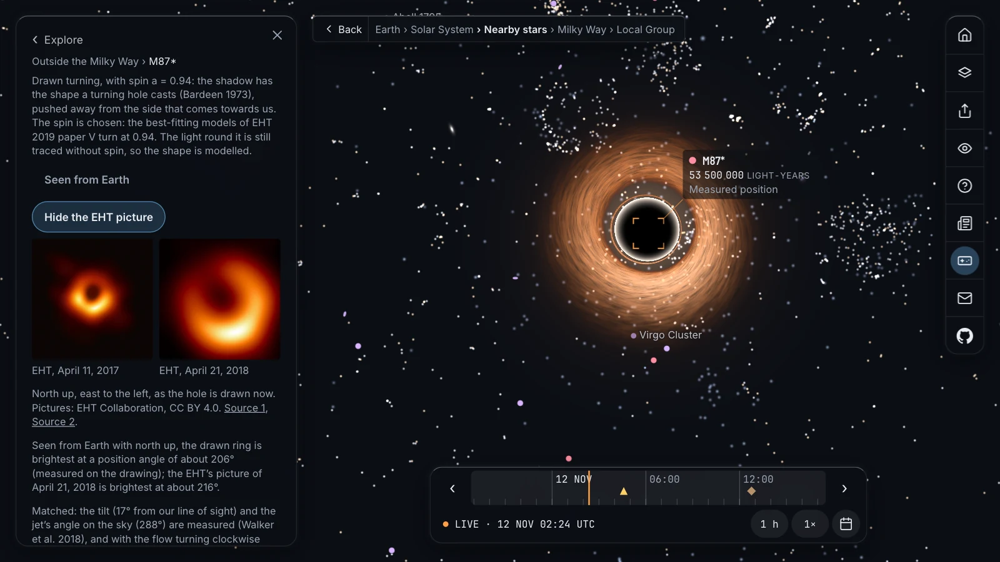
<h3>Black holes against the EHT</h3>
Sagittarius A* and M87* drawn spinning, their shadows sized from their measured masses, with "Seen
from Earth" and a slider to compare the drawing with the Event Horizon Telescope's picture. What is
measured and what is modelled is on the card.
</td>
<td valign="top">
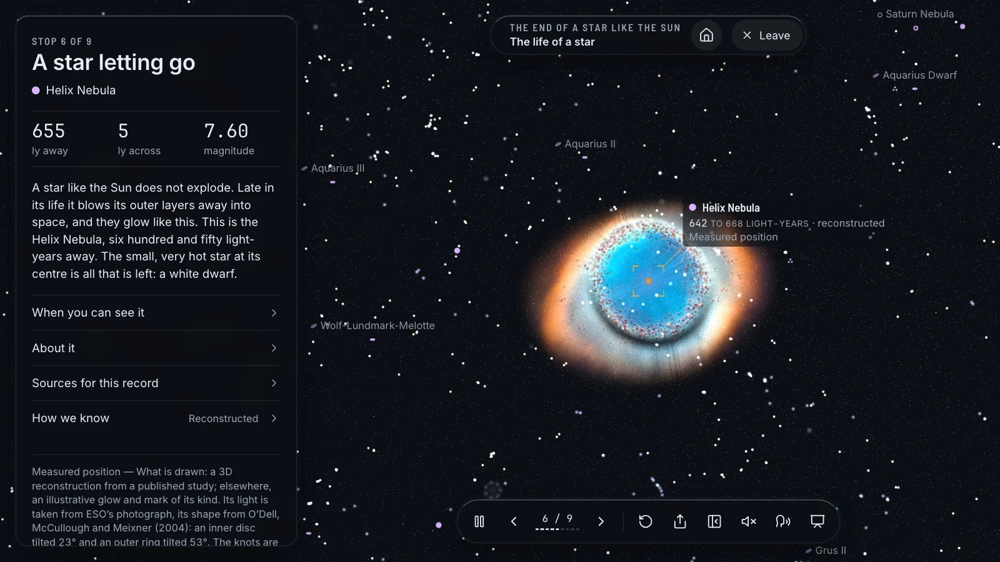
<h3>Narrated trips and Moments</h3>
33 trips and 248 stops, read aloud, with captions and music: tonight from your street, the Moon
landings, the life of a star, black holes. Present mode sets the words large for a room and waits for
your clicker.
</td>
</tr>
<tr>
<td valign="top">
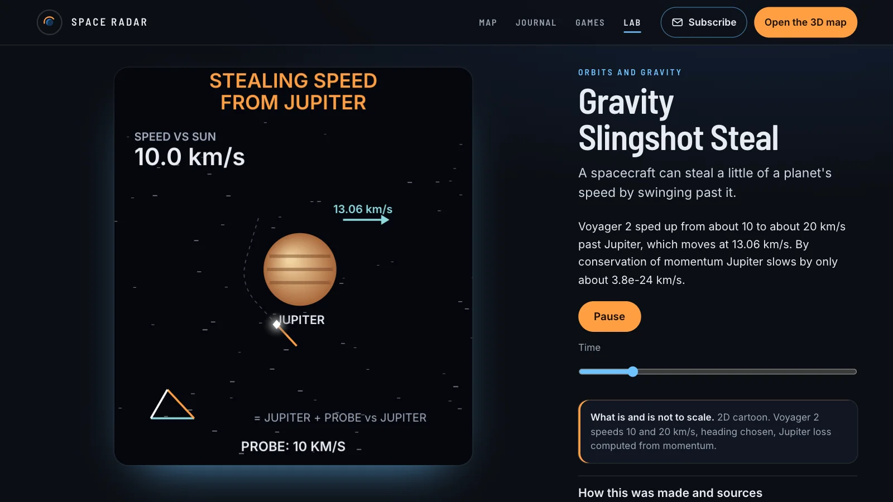
<h3>The Lab</h3>
105 tiny simulators, one idea each, every number quoted from its source: orbits near a black hole,
the rocket equation, a gravity slingshot, the seasons. Each is tagged by age and curriculum, and
<a href="docs/ADD_A_SIMULATOR.md">you can add one</a> in a single HTML file.
</td>
<td valign="top">
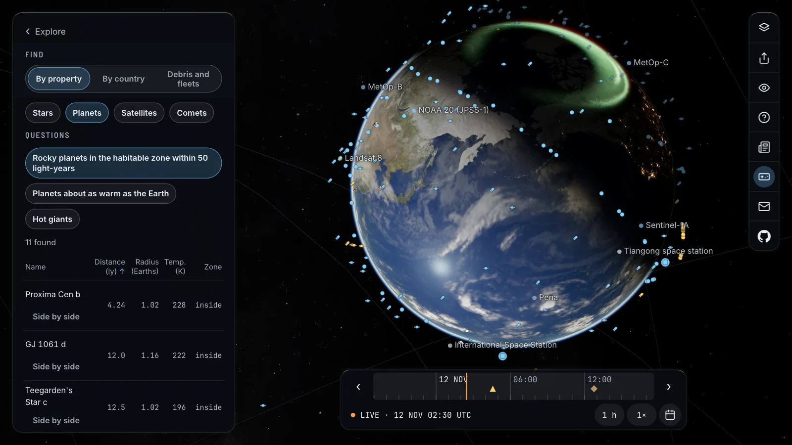
<h3>Find</h3>
Ask by property and get a sortable table: rocky planets in the habitable zone within 50 light-years,
satellites by country or operator, the pieces of a debris cloud. A row flies you there, and the link
keeps the question.
</td>
</tr>
<tr>
<td valign="top">
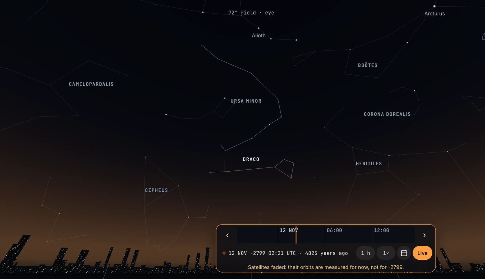
<h3>The time machine</h3>
Drag the clock to the next eclipse, type "20 July 1969", or take the sky 100 000 years either way:
the stars move, the Earth's axis turns, and Thuban, then Vega, becomes the pole star.
</td>
<td valign="top">
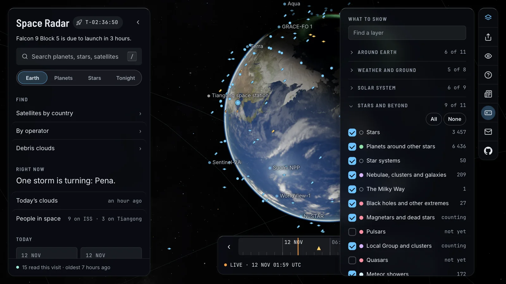
<h3>What to show</h3>
Every layer, from the space stations to the quasars, grouped and switched on and off in one panel,
each with where its data comes from and how old it is.
</td>
</tr>
<tr>
<td valign="top">
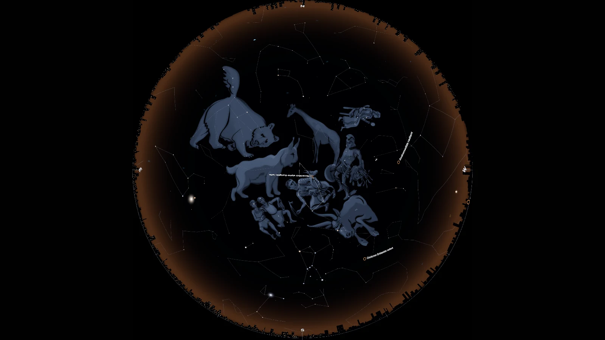
<h3>Record, dome and 360</h3>
Record a video of any view, flight path or trip, plan a camera flight and share it as a link, and
export a 180-degree dome master or a 360 frame for a planetarium. Every link carries the view:
copying the address bar shares what you see.
</td>
<td valign="top">
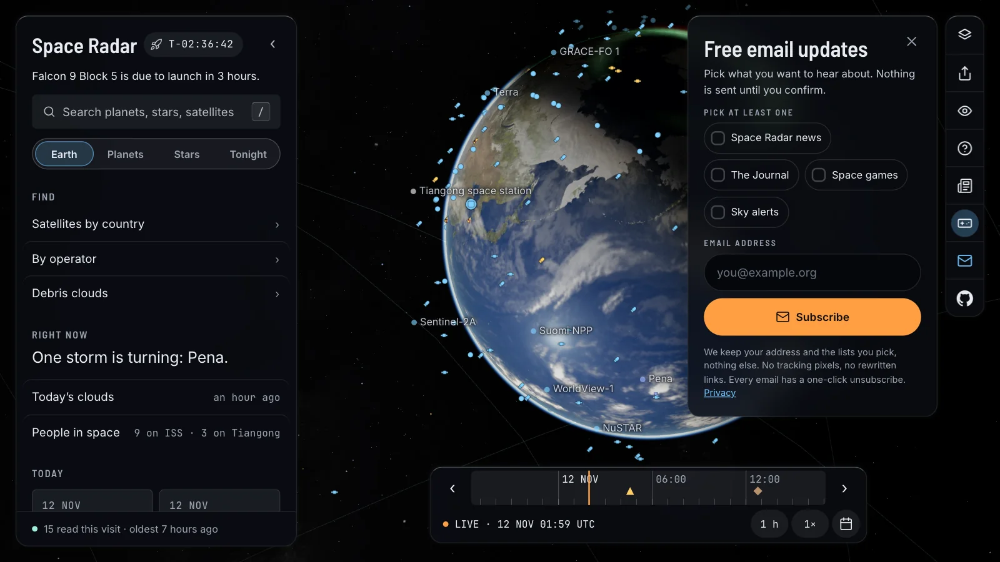
<h3>Free email updates</h3>
Pick any of Space Radar news, the Journal, Space games and sky alerts; none is ticked for you.
Nothing is sent until you confirm, every email has a one-click unsubscribe, and there are no tracking
pixels.
</td>
</tr>
</table>

**And also:**

- **VR and the gamepad.** A headset button where the browser can open WebXR, with a comfort note
  first, and an Xbox or PlayStation pad to fly with.
- **Put it in your page.** One live object or one trip as an [embed](docs/EMBEDDING.md), with no
  tracker and no cookie.
- **11 languages.** English, and Arabic, Chinese, French, German, Hebrew, Hindi, Portuguese, Russian,
  Spanish and Ukrainian drafted by machine and waiting for native readers
  ([how to help](docs/TRANSLATING.md), or
  [report a wrong phrase](https://github.com/Sara-Managed-Projects/space-radar/issues/new?template=mistranslation.yml)).
- **Offline.** After one visit it works with no connection and installs like an app. Each
  [release](https://github.com/Sara-Managed-Projects/space-radar/releases) is a zip with a saved copy
  of the data that starts with no internet, for a classroom or a museum.
- **Live Earth.** Clouds, storms, lightning and the aurora, fires, volcanoes and icebergs from NASA's
  EONET, the wind from NOAA's GFS, and today's sunspot groups.

### On a phone

The same map, one sheet, one thumb.

<p>
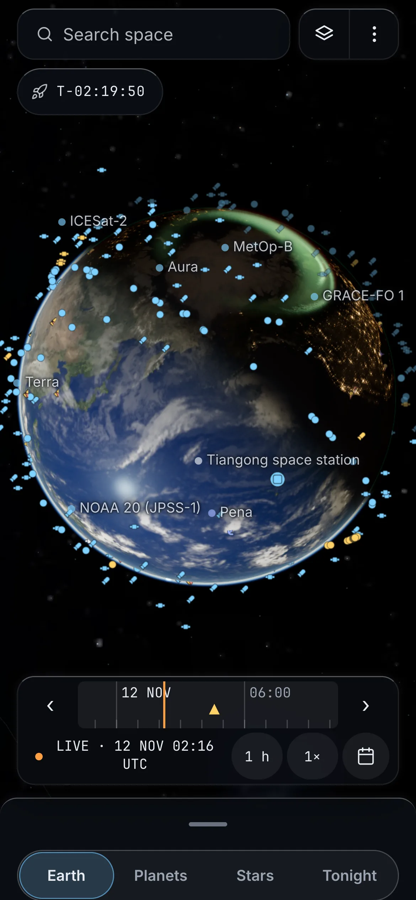
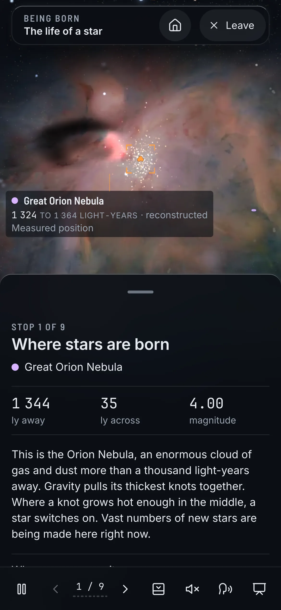
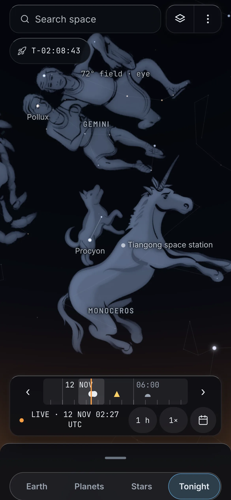
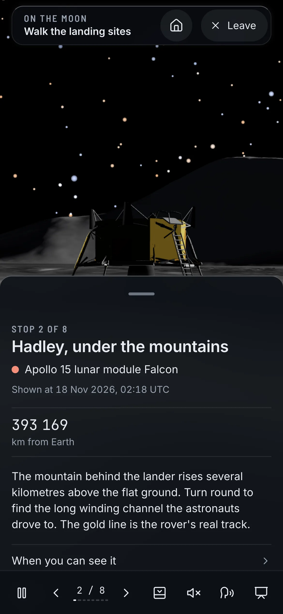
</p>

### The family of sites

| | |
|---|---|
| [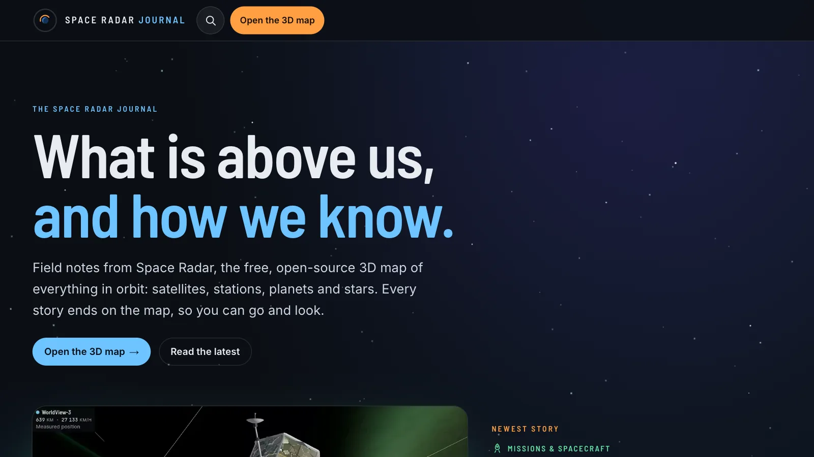](https://blog.spaceradar.ai) | [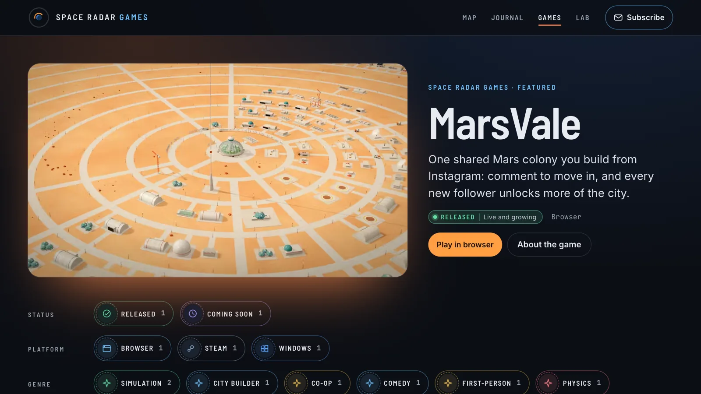](https://games.spaceradar.ai) |
| **[The Journal](https://blog.spaceradar.ai)**: field notes on what is above us and how we know, each story ending on the map. | **[Games](https://games.spaceradar.ai)**: space games from the same team, what each one is and how to play. |
| [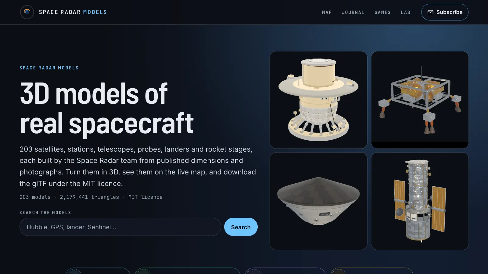](https://models.spaceradar.ai) | [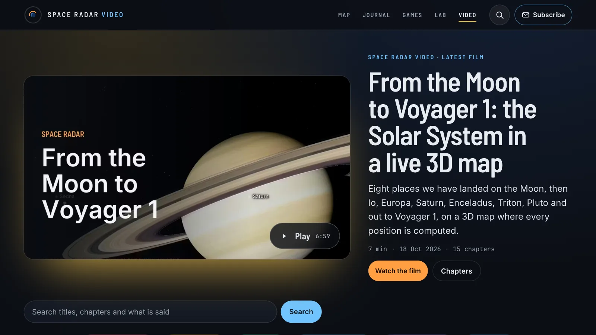](https://video.spaceradar.ai) |
| **[Models](https://models.spaceradar.ai)**: the 3D spacecraft, turned in 3D, seen live, and free to download as glTF. | **[Video](https://video.spaceradar.ai)**: narrated films flown in the map, with chapters and transcripts. |

## Why

- **Learning about space should be free and simple.** No account, no adverts, no tracking, no
  install. Open a link and you are looking at the sky as it is now.
- **It should run anywhere.** A school, a university, a kindergarten or a village library can
  [run its own copy](docs/RUN_LOCALLY.md), on an old laptop, with no internet at all.
- **It should be honest.** Everything drawn is measured, modelled or illustrative, and says which.
- **It is built in the open, in the AI era.** Much of this project was written by people working
  with AI assistants, held to account by tests and by sources. That makes it a good time to join
  in: an idea, a correction or a fix from you can be on the live site within days.

## You can help without writing code

- **Report a wrong number or name**, with a source: a
  [data-accuracy report](https://github.com/Sara-Managed-Projects/space-radar/issues/new?template=data-accuracy.yml).
- **Try it in a class or on a museum screen** and tell us what broke or worked: a
  [classroom report](https://github.com/Sara-Managed-Projects/space-radar/issues/new?template=classroom.yml).
- **Translate it:** [docs/TRANSLATING.md](docs/TRANSLATING.md), or
  [offer a language](https://github.com/Sara-Managed-Projects/space-radar/issues/new?template=translation.yml).
- **Suggest or review a trip.** Astronomers: read one trip's narration for errors.
- **Edit a word on GitHub**, with no tools at all: [CONTRIBUTING.md](CONTRIBUTING.md) shows how.
- **Build a tiny space simulator** in one HTML file: [docs/ADD_A_SIMULATOR.md](docs/ADD_A_SIMULATOR.md),
  shelf at [spaceradar.ai/lab](https://www.spaceradar.ai/lab/index.html).

If Space Radar is useful to you, a star helps other people find it.

## Run it locally

```bash
git clone https://github.com/Sara-Managed-Projects/space-radar.git
cd space-radar
python3 -m http.server 8177 --directory site      # then open http://localhost:8177
```

That is the whole toolchain: there is nothing to install or compile. For Windows, classrooms,
a school server, a USB stick, and **running with no internet**, see
**[docs/RUN_LOCALLY.md](docs/RUN_LOCALLY.md)**. Each [release](https://github.com/Sara-Managed-Projects/space-radar/releases)
is a zip that already contains a saved copy of the data and starts offline.

### Links

The address bar is the view: what is selected, the moment on the clock, the map and the trip stop
are all in it, so copying it is sharing what you see. A trip has two link forms. `/t/<trip>.html`
is a small page of its own with the trip's picture and words, the one to paste into a chat or a
post so it unfurls; it opens the app at the trip. `#trip=<trip>&stop=<n>` is the app itself at
that stop. Moving through a trip does not add to the browser's history: Back is not "previous
stop", it leaves the trip for the page you came from (the trip has its own Previous).

## How it is built

```
site/        the whole app, served as it is: plain ES modules, three.js, no bundler, no framework
registry/    YAML files that say what exists: worlds, layers, data sources, trips, models, budgets
scripts/     generators that turn a registry into the JavaScript the browser reads, and the checks
tests/       more than 400 node and python test files; no browser needed
harvest/     the hourly job that saves each public data source on our own storage, for the site to read first
docs/        running it, a first pull request, a map of the code, embedding, releasing
```

Adding a moon, a landing site, a search alias or a whole trip is a **row in a registry**, not a
code change, and CI holds the project to that. Satellites move by SGP4, asteroids and comets by
Kepler's equation, the Sun, Moon and planets by an ephemeris library, all in the browser.

## Contributing

It is meant to be easy and fun.

- **[Your first pull request, in ten minutes](docs/FIRST_PR.md)**: fork, run, change, check with one
  command (`scripts/check.sh`), and what happens after you open it. Or press
  [Open in Codespaces](https://codespaces.new/Sara-Managed-Projects/space-radar) and install nothing.
- **[A map of the code](docs/ARCHITECTURE.md)**: one page, with the file to edit for the commonest
  changes.
- **[Four ways in](docs/CONTRIBUTE_WITHOUT_CODE.md)**: fix a fact, translate, add a sky culture or a
  trip stop, or write code.
- **[CONTRIBUTING.md](CONTRIBUTING.md)**: recipes for a trip, an object or a layer, and the style.
  [GOVERNANCE.md](GOVERNANCE.md) says who decides; [CONTRIBUTORS.md](CONTRIBUTORS.md) says who has helped.
- Want a first task? [Pick one by what you like doing](docs/FIRST_PR.md#pick-a-task-2-minutes): the list
  shows only the starter issues nobody has begun. Every first comment gets an answer within 48 hours.
  Larger work is marked [help wanted](https://github.com/Sara-Managed-Projects/space-radar/labels/help%20wanted).
- Please read the [Code of Conduct](CODE_OF_CONDUCT.md). Security reports go through
  [SECURITY.md](SECURITY.md); other help is in [SUPPORT.md](SUPPORT.md).

Releases come out often; see the [changelog](CHANGELOG.md) and [how we release](docs/RELEASING.md).

Translations, as they stand (all machine-drafted and not yet shown from a browser's language until two native readers have read them; [how to help](docs/TRANSLATING.md)):<br>
<!-- translation-badges:begin (node scripts/check-translation.mjs --write-doc) -->
[](docs/TRANSLATING.md)
[](docs/TRANSLATING.md)
[](docs/TRANSLATING.md)
[](docs/TRANSLATING.md)
[](docs/TRANSLATING.md)
[](docs/TRANSLATING.md)
[-99.9%20%25%20agent--reviewed-yellowgreen)](docs/TRANSLATING.md)
[](docs/TRANSLATING.md)
[](docs/TRANSLATING.md)
[](docs/TRANSLATING.md)
<!-- translation-badges:end -->

## Support

Space Radar is free and open source, and it stays that way: no paid tier, no account, no adverts,
no tracking. If you would like to help pay for the hosting, the data and the time to build, there is a
page on [Buy Me a Coffee](https://buymeacoffee.com/spaceradar). A star, a
[data-accuracy report](https://github.com/Sara-Managed-Projects/space-radar/issues/new?template=data-accuracy.yml)
or a [first pull request](docs/FIRST_PR.md) helps just as much.

## Data and credits

Space Radar stands on data and work that other people publish for free. Thank you.

**Data and APIs**

[](https://celestrak.org)
[](https://ssd.jpl.nasa.gov)
[](https://thespacedevs.com/llapi)
[](https://nasa-gibs.github.io/gibs-api-docs/)
[](https://trek.nasa.gov)
[](https://www.swpc.noaa.gov)
[](https://nowcoast.noaa.gov)
[](https://www.gdacs.org)
[](https://exoplanetarchive.ipac.caltech.edu)
[](https://eyes.nasa.gov/dsn/)
[](https://www.wikidata.org)
[](http://open-notify.org)

**Catalogues, maps, models and pictures**

[](https://codeberg.org/astronexus/hyg)
[](https://github.com/mattiaverga/OpenNGC)
[](https://github.com/nasa/NASA-3D-Resources)
[](https://www.solarsystemscope.com/textures/)
[](https://www.naturalearthdata.com)
[](https://stellarium.org)
[](CREDITS.md#3h-the-sky-in-other-light--nasas-wise-wmap-and-fermi-through-cds-hips)
[](CREDITS.md)

**Code, type and sound**

[](https://threejs.org)
[](https://github.com/shashwatak/satellite-js)
[](https://github.com/cosinekitty/astronomy)
[](https://lucide.dev)
[](CREDITS.md#10-fonts)
[-2da44e)](CREDITS.md#9-audio--music-and-sounds)
[-2da44e)](CREDITS.md#9b-audio--the-trips-narration-a-synthetic-voice)

**[CREDITS.md](CREDITS.md)** has every one of them with its licence, its required credit line and
what we changed. None of these organisations endorses Space Radar.

> **Forking it?** Read [CelesTrak's usage policy](CREDITS.md#41-celestrak--read-this-before-you-deploy-a-fork)
> first: one download per file per two hours. The app's cache honours it; please keep that.

## Licence

- **The code** (everything we wrote: `site/js`, `site/css`, `scripts`, `tests`, `harvest`, `tools`,
  the registries and these documents) is **[MIT](LICENSE)**.
- **Data and assets keep their owners' licences**: vendored libraries (MIT, ISC, BSD), planet maps
  (CC BY 4.0 and public domain), star catalogues (CC BY-SA 4.0, BSD), photographs (CC BY 4.0), the other-light sky tiles (ODbL 1.0),
  the constellation pictures (Free Art License 1.3, copyleft: `site/data/skyart/LICENSE.txt`), other peoples' sky figures (CC BY-SA 4.0),
  NASA models (public domain), fonts (SIL OFL 1.1), music (CC0). Data fetched live or saved under
  `site/data/v1/` belongs to its publisher under the publisher's terms. [CREDITS.md](CREDITS.md)
  is the full list, including the few terms we have not been able to confirm.
  <!-- b200-c1-culture: begin --> The Māori, Hawaiian and Boorong constellation pictures and every sky figure's story
  are CC BY-SA 4.0, from Stellarium (`site/data/skyart/<culture>/LICENSE.txt`, `site/data/skystories/`). <!-- b200-c1-culture: end -->
  <!-- b200-f10-stars3d: begin --> The 3D map's 2.4 million AT-HYG stars (`site/data/stars3d-athyg/`) are CC BY-SA 4.0, from
  AT-HYG v4.0 by David Nash. <!-- b200-f10-stars3d: end -->
- The pictures in `assets/screenshots/` are screenshots of Space Radar and of its sister sites. Use them with the
  credit "Space Radar (spaceradar.ai)"; the [creators' page](https://www.spaceradar.ai/creators/index.html) lists the
  makers of the maps and catalogues to credit too, and the few catalogues that are for non-commercial use only.
- The GitHub mark in the app is GitHub's trademark, used unmodified under GitHub's logo rules.

<div align="center">
<sub>Built with real orbital mechanics and a lot of respect for the people who publish the data for free.</sub>
</div>
